<p align="center">
  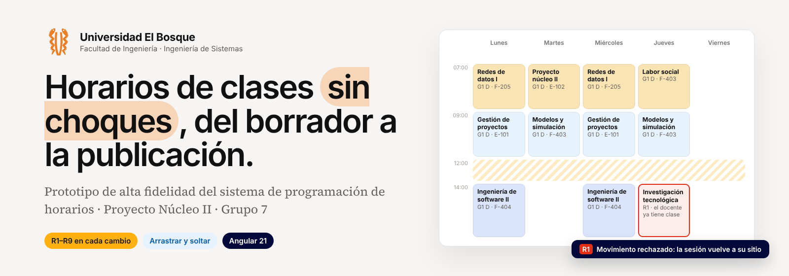
</p>

<p align="center">
  
  
  
  
  
  
</p>

<p align="center">
  <b>Prototipo funcional de alta fidelidad del sistema de programación de horarios de clases</b><br>
  Programa de Ingeniería de Sistemas · Facultad de Ingeniería · Universidad El Bosque<br>
  Hernando Javier García Mogollón · Jhonatan Lara Gómez · Juanita Mejía Pineda · Laura Gabriela Díaz Amaya · Santiago Pinzón Vásquez
</p>

<p align="center">
  <a href="https://horarios-ueb.vercel.app"><b>🚀 Ver la demo en vivo → horarios-ueb.vercel.app</b></a> · contraseña <code>demo123</code>
</p>

<p align="center">
  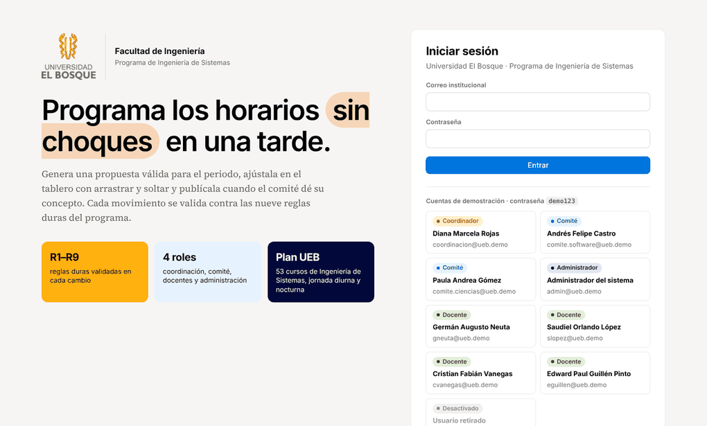
</p>

> [!NOTE]
> Es el **front-end en Angular** de la arquitectura definida en el entregable (Angular + Spring Boot + MySQL). Para poder probarlo sin servidor, el backend está **simulado dentro del navegador**: valida permisos por rol, aplica las reglas R1–R9, versiona el horario y escribe la bitácora. Todos los datos son **de demostración**.

---

## 📑 Contenido

- [El problema](#-el-problema)
- [Qué hace el prototipo](#-qué-hace-el-prototipo)
- [Roles y cuentas de demostración](#-roles-y-cuentas-de-demostración)
- [Recorrido por las pantallas](#-recorrido-por-las-pantallas)
- [Normas y reglas del negocio](#-normas-y-reglas-del-negocio)
- [Cómo arma el horario el generador](#-cómo-arma-el-horario-el-generador)
- [Datos de demostración](#-datos-de-demostración)
- [Arquitectura del prototipo](#-arquitectura-del-prototipo)
- [Guía de instalación y ejecución](#-guía-de-instalación-y-ejecución)
- [Despliegue en Vercel](#-despliegue-en-vercel)
- [Trazabilidad con los requerimientos](#-trazabilidad-con-los-requerimientos)
- [Solución de problemas](#-solución-de-problemas)
- [Documentos del proyecto](#-documentos-del-proyecto)

## 🤔 El problema

El caso *«El Reto de la Programación de Horarios de Clases»* describe cómo el Programa arma hoy los horarios en hojas de cálculo: cada semestre hay que cruzar a mano docentes con su vinculación y disponibilidad, cursos con sus sesiones semanales, aulas con capacidades y características distintas, y grupos que no pueden pasar de 40 estudiantes (con 10 % de tolerancia). Cualquier cambio de última hora puede dejar a un docente en dos salones a la vez o a un grupo de 40 en un aula de 30, y nadie lo nota hasta el primer día de clases.

El sistema propuesto genera una propuesta válida, deja ajustarla arrastrando sesiones sin romper ninguna regla, la somete al concepto del comité y la publica solo cuando no tiene choques.

## ✨ Qué hace el prototipo

| | Funcionalidad | Dónde verla |
|---|---|---|
| ⚙️ | Periodos académicos con sus propios parámetros (franjas, bloque no asignable, cupos, horas por vinculación) | *Periodos y parámetros* |
| 🧑‍🏫 | Docentes con vinculación, escalafón, cursos habilitados y disponibilidad semanal (editor de grilla) | *Docentes* · *Mi disponibilidad* |
| 🏫 | 86 aulas reales por bloque y piso (A, B, E, F, G, I) con salas de cómputo, laboratorios de redes y de física | *Aulas* |
| 📥 | Importación CSV **todo o nada**: si una fila falla no se carga nada y se listan las filas con su motivo | *Importar datos* |
| 👥 | Demanda por curso, sugerencia de número de grupos y docente preferente por grupo | *Grupos y demanda* |
| 🪄 | **Generación automática** de la propuesta en milisegundos, con grupos pendientes y su causa | *Tablero* |
| 🖱️ | **Tablero semanal con arrastrar y soltar**: cada movimiento se valida contra R1–R9 y, si viola una regla, la sesión vuelve y se nombra la regla | *Tablero* |
| 🎨 | **Vista por curso**: un color por grupo, con su horario y docente; por semestre, un color por curso | *Tablero → Por curso* · *Consultar horario → Curso* |
| 🗂️ | **Ficha del grupo**: datos, horario (día, hora, aula, docente) o causa del pendiente, y su configuración | *Grupos y demanda* → clic en el grupo |
| 📊 | Restricciones blandas B1–B6 (informativas, no bloquean) | *Tablero → Restricciones blandas* |
| 🗳️ | Concepto del comité por versión, publicación bloqueada si hay choques o pendientes, restauración de versiones | *Revisión* · *Versiones* |
| 🔎 | Consulta por docente, aula, curso o semestre y exportación a CSV y PDF | *Consultar horario* · *Mi horario* |
| 📈 | Reportes de ocupación de aulas, carga docente y grupos bajo el mínimo; registro de inscritos y cierre de grupos | *Reportes* · *Inscritos y cierre* |
| 🔐 | Inicio de sesión, menú y rutas por rol, rechazo en el "servidor" de acciones sin permiso y bitácora de auditoría | *Login* · *Bitácora* · *Trazabilidad* |

## 👥 Roles y cuentas de demostración

Todas las cuentas usan la contraseña **`demo123`**. En la pantalla de inicio de sesión basta con hacer clic en la cuenta; cada una lleva una marquilla con el color de su rol y debajo hay un desplegable que explica qué hace cada rol.

| Rol | Cuenta | Qué puede hacer |
|---|---|---|
| 🟡 **Coordinador de horarios** | `coordinacion@ueb.demo` | Todo el proceso del periodo: parámetros, catálogo, importación, grupos, generación, tablero, publicación, reportes, inscritos y bitácora. |
| 🔵 **Comité Táctico / de Área** | `comite.software@ueb.demo` · `comite.ciencias@ueb.demo` | Revisa las versiones en modo lectura y registra su concepto. No puede tocar el horario. |
| 🟢 **Docente** | `cvanegas@ueb.demo` · `eguillen@ueb.demo` · `slopez@ueb.demo` · `gneuta@ueb.demo` | Ve y exporta **solo su horario publicado** y registra su disponibilidad. |
| ⚫ **Administrador** | `admin@ueb.demo` | Usuarios y roles; además periodos, consulta y bitácora. |
| ⚪ Desactivado | `retirado@ueb.demo` | No puede iniciar sesión (prueba de RF-22). |

<p align="center">
  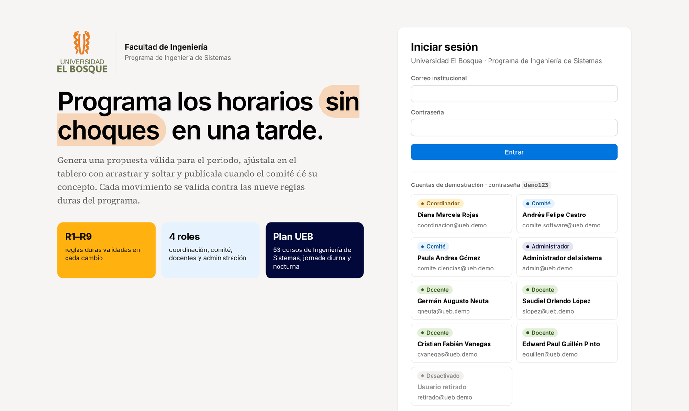
</p>

## 🧭 Recorrido por las pantallas

El menú del coordinador sigue el orden del proceso del BPMN: **Planeación → Programación → Seguimiento**. Cada pantalla indica en su encabezado los casos de uso y requerimientos que cubre.

<table>
  <tr>
    <td width="50%">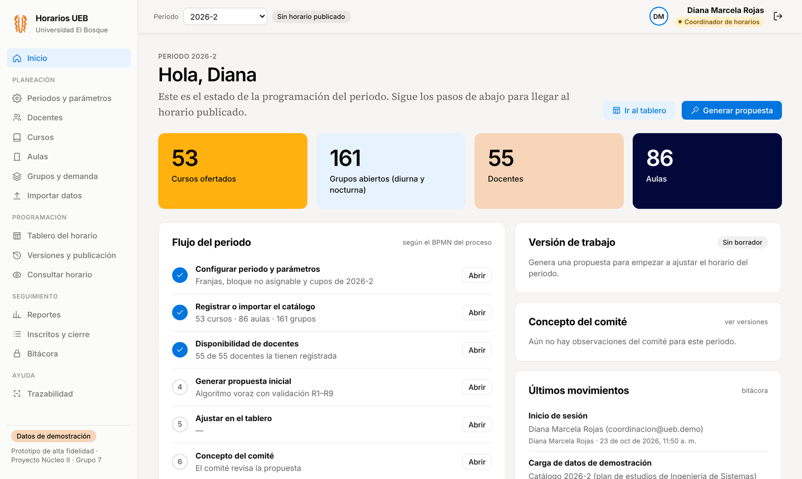<br><b>Inicio</b> · estado del periodo y los 7 pasos del flujo, con lo hecho y lo pendiente.</td>
    <td width="50%">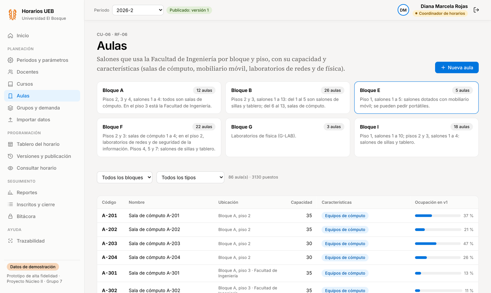<br><b>Aulas</b> · 86 salones por bloque y piso; clic en un bloque para filtrar.</td>
  </tr>
  <tr>
    <td>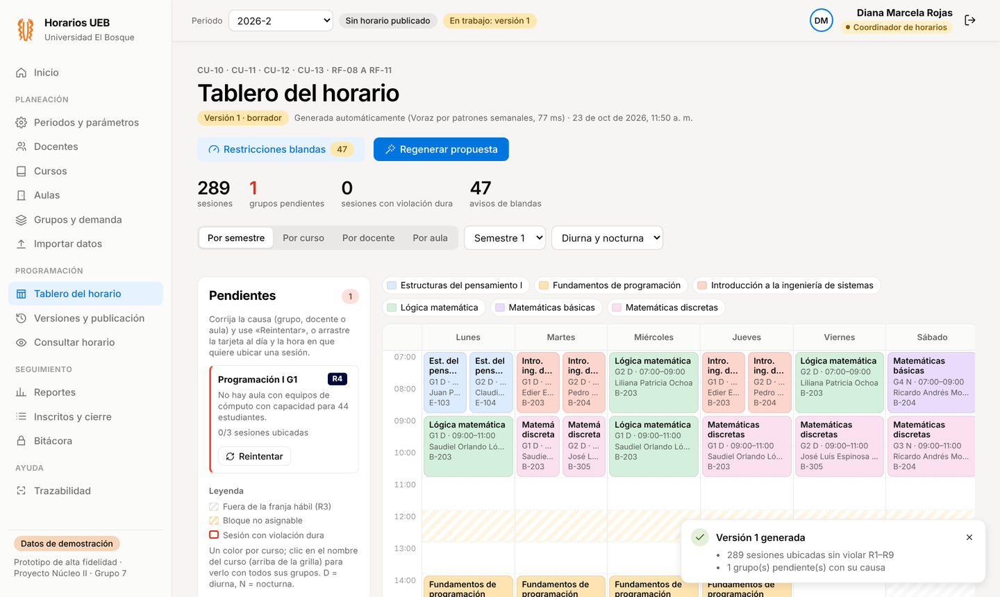<br><b>Tablero</b> · propuesta generada, bandeja de pendientes con su regla y causa.</td>
    <td>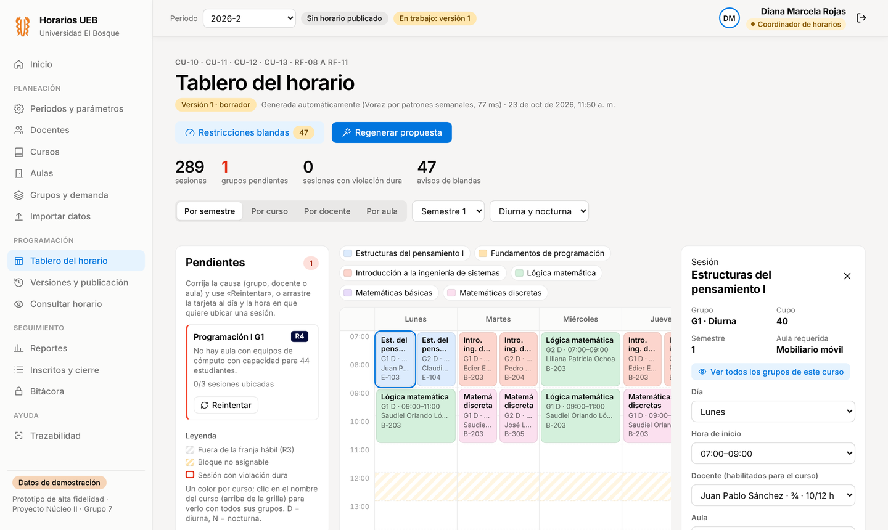<br><b>Detalle de sesión</b> · cambiar día, hora, docente (solo habilitados) o aula, validando R1–R9.</td>
  </tr>
  <tr>
    <td>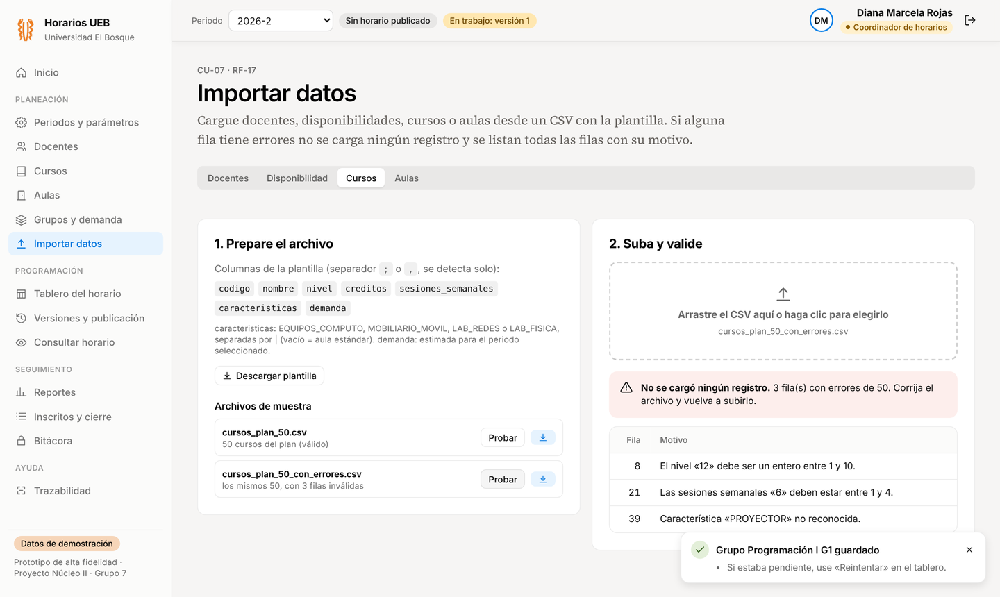<br><b>Importar CSV</b> · 50 filas con 3 inválidas: no carga nada y lista las filas 8, 21 y 39.</td>
    <td>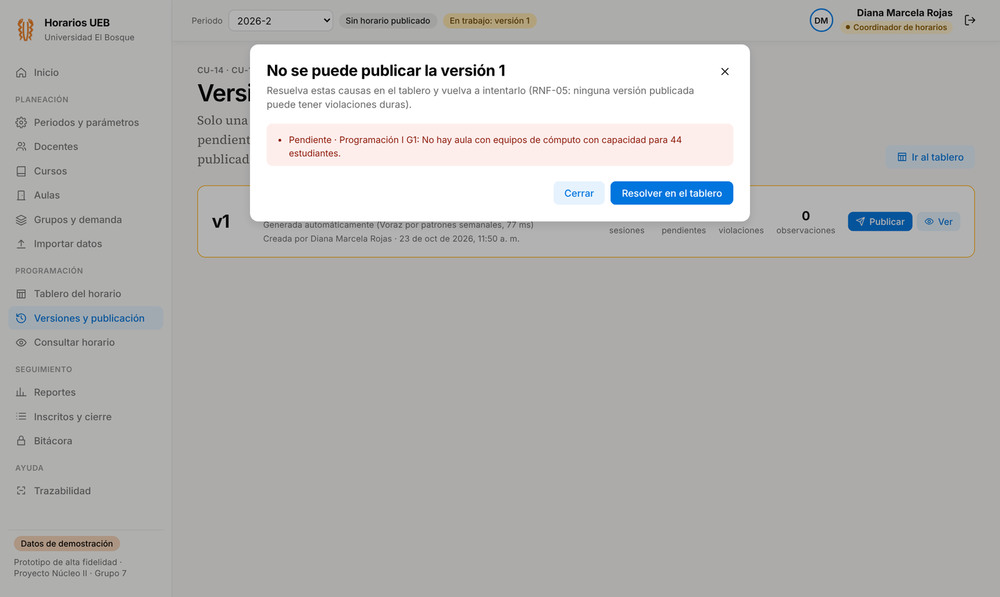<br><b>Publicación bloqueada</b> · no se publica con grupos pendientes ni violaciones duras.</td>
  </tr>
  <tr>
    <td>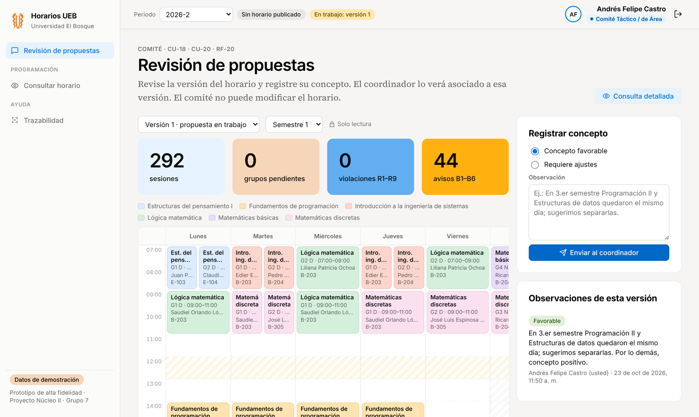<br><b>Comité</b> · revisa por semestre y registra su concepto para la versión.</td>
    <td>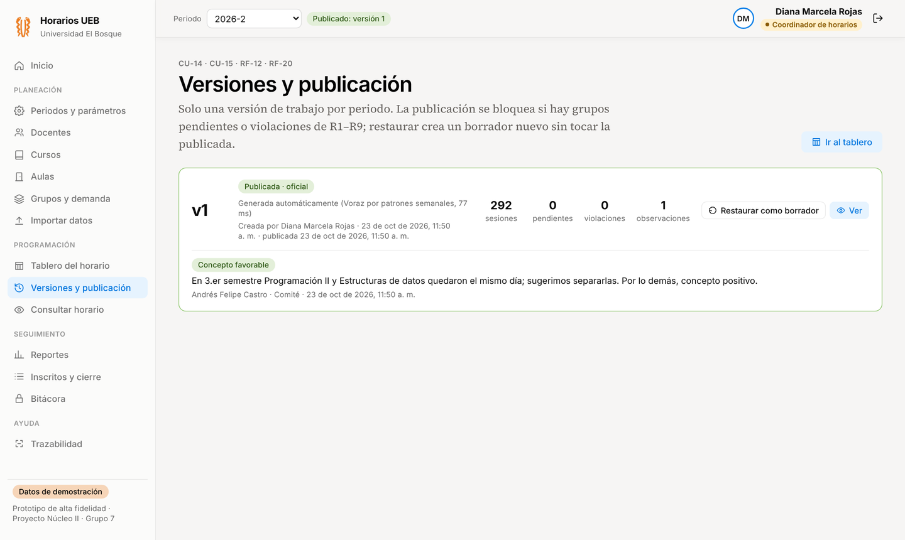<br><b>Versiones</b> · publicada con la observación del comité; restaurar crea un borrador nuevo.</td>
  </tr>
  <tr>
    <td>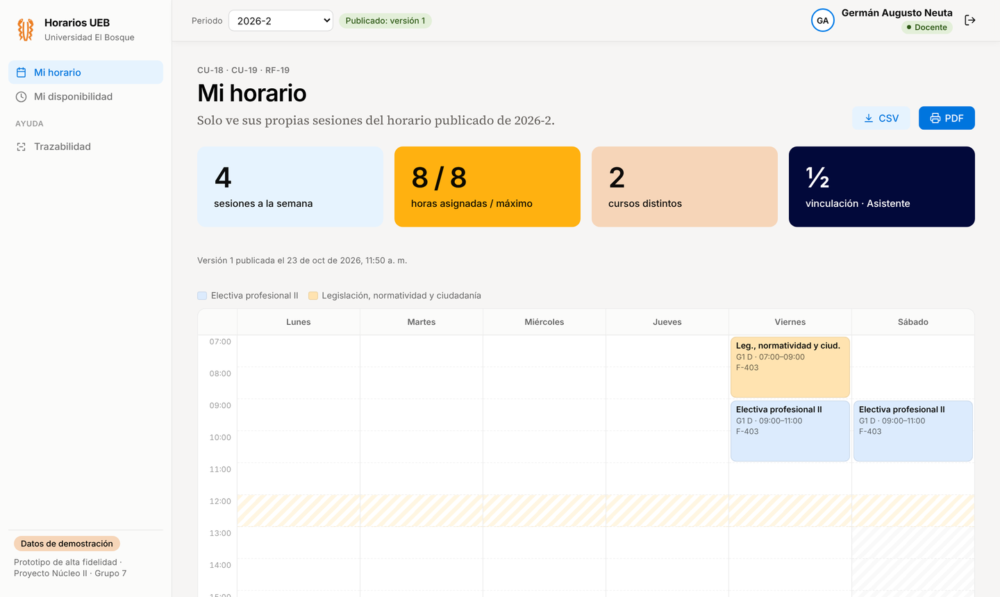<br><b>Mi horario</b> · el docente solo ve sus sesiones publicadas y las exporta.</td>
    <td>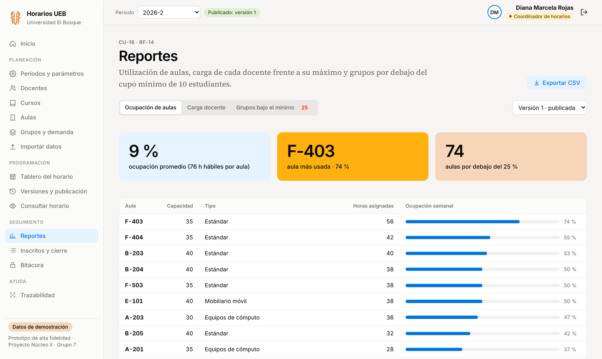<br><b>Reportes</b> · ocupación de aulas, carga docente y grupos bajo el mínimo.</td>
  </tr>
</table>

## 📐 Normas y reglas del negocio

### Parámetros por defecto (editables por periodo, RF-01 · RF-02 · RF-16)

| Parámetro | Valor |
|---|---|
| Franja lunes a viernes | 07:00 – 22:00 |
| Franja sábado | 07:00 – 13:00 |
| Bloque no asignable | 12:00 – 13:00 |
| Duración de la sesión | 2 horas |
| Cupo máximo por grupo | 40 + 10 % de tolerancia = **44** (cupo efectivo) |
| Cupo mínimo para no cerrar | 10 inscritos |
| Sesiones por semana | 1 a 4 (según créditos: 1 → 1, 2–3 → 2, 4 → 3) |
| Horas máximas por vinculación | TC 16 · ¾ 12 · ½ 8 · ¼ 4 *[confirmar con la Facultad]* |

### Norma de grupos y jornadas del Programa

> [!IMPORTANT]
> - **En el día**, cada curso abre **mínimo dos grupos (G1 y G2)** y los dictan **dos docentes distintos**.
> - **En la noche**, cada curso abre **un grupo (G3)**; solo cuando la demanda lo justifica abre un segundo (**G4**, como Matemáticas básicas y Cálculo diferencial). Nunca más de dos.
> - La **jornada diurna** usa 07–09, 09–11, 14–16 y 16–18 de lunes a viernes; la **nocturna** usa 18–20 y 20–22 de lunes a viernes y el **sábado en la mañana**.
> - **Un grupo tiene como máximo una sesión por día** (regla dura R8): nunca dos bloques de la misma materia el mismo día, tampoco el sábado.
> - La norma de **dos docentes distintos en el día es ideal, no obligatoria**: casi siempre se cumple, pero hay casos en que no hay otro docente. El generador busca primero un docente distinto y, si no lo hay, repite docente y la versión lo reporta como restricción blanda **B6** (no bloquea la publicación).

### Docentes con usuario en la demo (asignaciones acordadas)

Estos grupos guardan un **docente preferente**: el generador intenta primero a ese docente y así sus horarios quedan como se acordó.

| Docente | Jornada | Cursos |
|---|---|---|
| Edward Paul Guillén Pinto | Noche (lunes a viernes) | Redes de datos I, Redes de datos II, Investigación tecnológica y de ingeniería, Seguridad de la información |
| Cristian Fabián Vanegas | Tarde-noche | Fundamentos de programación, Dirección y planeación, Gestión de proyectos, Proyecto núcleo II |
| Saudiel Orlando López | Día, sábados y viernes en la noche | Historia y filosofía de la ingeniería, Matemáticas discretas, Gestión de tecnología e innovación, Seminario de investigación, Lógica matemática |
| Germán Augusto Neuta | Viernes y sábados | Legislación, normatividad y ciudadanía, Electiva profesional II |

### Restricciones duras (bloquean · RF-09)

Cada una es una clase en `src/app/core/rules/reglas-duras.ts` (patrón Specification). Se evalúan al generar, al mover una sesión, al editarla desde el panel y antes de publicar.

| Regla | Qué impide |
|---|---|
| **R1** | Un docente con dos sesiones a la vez |
| **R2** | Un aula con dos sesiones a la vez |
| **R3** | Sesiones fuera de la franja hábil o sobre el bloque no asignable |
| **R4** | Aulas sin la capacidad o las características que pide el curso |
| **R5** | Docentes no habilitados para el curso |
| **R6** | Sesiones fuera de la disponibilidad del docente |
| **R7** | Superar las horas máximas de docencia del docente |
| **R8** | Más sesiones semanales de las permitidas, o **dos sesiones del mismo grupo el mismo día** |
| **R9** | Grupos con cupo por encima del cupo efectivo |

### Restricciones blandas (se reportan, no bloquean · RF-11)

| Regla | Qué reporta |
|---|---|
| **B1** | Cursos de 2 o 3 sesiones en días seguidos |
| **B2** | Huecos de 2 h o más en el día de un docente (el almuerzo no cuenta) |
| **B3** | Docentes al 100 % mientras otros no tienen clases |
| **B4** | Cruces entre cursos del mismo semestre y jornada |
| **B5** | Aulas especiales usadas por cursos que no las necesitan |
| **B6** | Dos grupos diurnos del mismo curso con el mismo docente (norma del Programa) |

## 🧠 Cómo arma el horario el generador

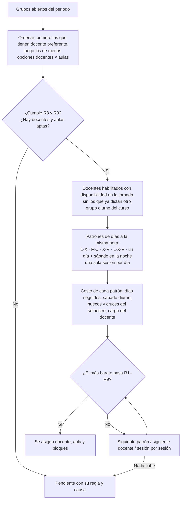

El resultado con los datos de demostración: **~289 sesiones en milisegundos, 0 violaciones duras** y 1 pendiente intencional para probar su resolución (*Programación I G1* por R4). *Investigación tecnológica* queda con la misma docente en G1 y G2 y aparece como aviso **B6**. Así queda, por ejemplo, el 6.º semestre:

<p align="center">
  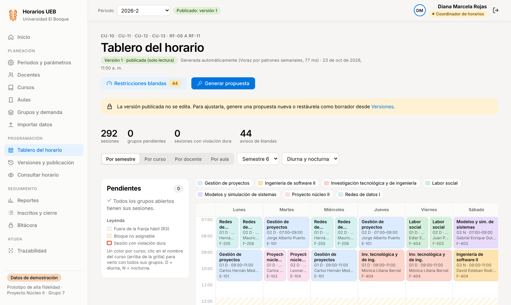
</p>

## 🗂️ Datos de demostración

- **Plan de estudios** real de Ingeniería de Sistemas de la UEB: 53 cursos de 1.º a 9.º semestre.
- **Periodos:** 2026-1 cerrado con su horario publicado y 2026-2 abierto, sin versiones.
- **161 grupos** en 2026-2 según la norma de jornadas.
- **55 docentes.** Los nombres reales vienen del Excel de horarios de referencia; los demás son ficticios. Vinculación, escalafón, disponibilidad y correos (`@ueb.demo`) son inventados.
- **86 aulas** en los bloques que usa la Facultad:

| Bloque | Pisos y salones | Tipo |
|---|---|---|
| **A** | Pisos 2, 3 y 4 · salones 1–4 (en el piso 3 está la **Facultad de Ingeniería**) | Salas de cómputo |
| **B** | Pisos 2 y 3 · salones 1–13 | 1–5 sillas y tablero · 6–13 salas de cómputo |
| **E** | Piso 1 · salones 1–5 | Mobiliario móvil (se pueden pedir portátiles) |
| **F** | Pisos 2, 3, 4, 5 y 7 | Pisos 2–3 salas de cómputo y laboratorios de redes y de seguridad (piso 2) · pisos 4, 5 y 7 sillas y tablero |
| **G** | G-LAB1 a G-LAB3 | Laboratorios de física |
| **I** | Piso 1 · salones 1–10 · pisos 2 y 3 · salones 1–4 | Sillas y tablero |

- **CSV de muestra** (válidos y con errores) en [`public/muestras/`](public/muestras).

## 🏗️ Arquitectura del prototipo

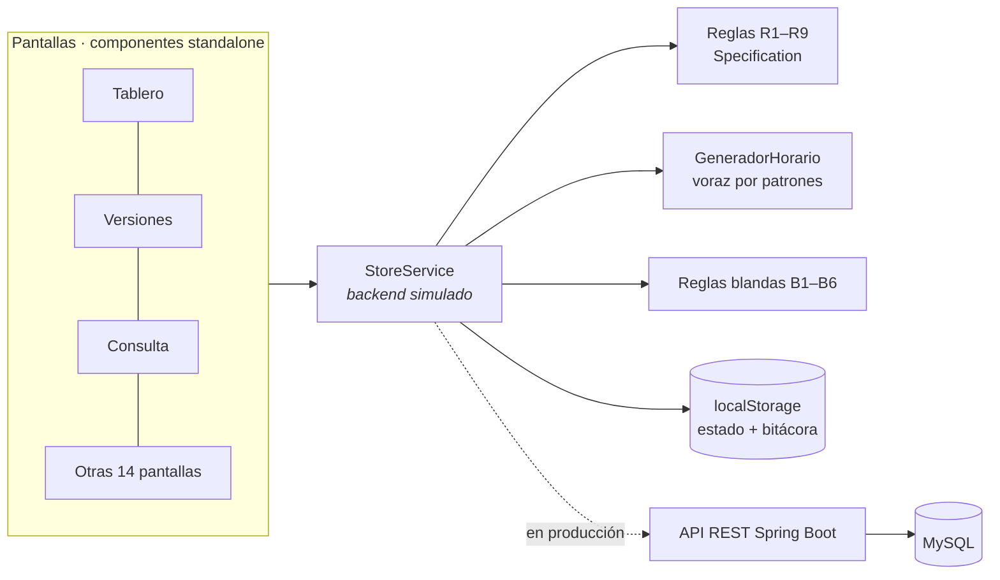

| Carpeta | Contenido |
|---|---|
| `src/app/core/models.ts` | Entidades del diagrama de clases y del MER |
| `src/app/core/rules/` | Reglas duras R1–R9, validador y reglas blandas B1–B6 |
| `src/app/core/scheduling/` | Generador por patrones semanales (interfaz `GeneradorHorario`, intercambiable) |
| `src/app/core/services/` | `StoreService` (hace de backend: permisos, reglas, versiones, bitácora), sesión y avisos |
| `src/app/core/import/` | Importación CSV todo o nada |
| `src/app/core/data/` | Datos de demostración (plan, docentes, aulas, grupos) y matriz de trazabilidad |
| `src/app/features/` | Una carpeta por pantalla (carga diferida por ruta y guardas por rol) |
| `src/app/shared/` | Grilla semanal, editor de disponibilidad, modal, iconos, avisos |

**Stack:** Angular 21 (componentes standalone, signals, sin zone.js, control flow `@if/@for`), Angular CDK para arrastrar y soltar, SCSS con los tokens del DESIGN.md del equipo (estilo Notion), Inter y Source Serif 4.

## 🧰 Guía de instalación y ejecución

> [!TIP]
> Solo necesitas **Node.js 20.19 o superior** (o 22.12+). Compruébalo con `node -v`.

```bash
git clone https://github.com/Chocax/horarios-ueb.git
cd horarios-ueb
npm install
npm start          # abre http://localhost:4200
```

| Comando | Qué hace |
|---|---|
| `npm start` | Servidor de desarrollo con recarga en caliente |
| `npm run build` | Compilación de producción en `dist/horarios-ueb/browser` |

El archivo `.npmrc` trae `legacy-peer-deps=true` para evitar conflictos de dependencias de npm. Los datos viven en el `localStorage` de tu navegador: el botón **Restablecer datos de demostración** del inicio de sesión los deja como al principio.

## ▲ Despliegue en Vercel

1. Sube el repositorio a GitHub.
2. En [vercel.com](https://vercel.com) → **Add New → Project** → importa el repositorio.
3. Vercel detecta Angular solo. Si pide datos: *Build command* `npm run build` · *Output directory* `dist/horarios-ueb/browser`.
4. **Deploy.** Cada `git push` a `main` vuelve a desplegar.

Las rutas usan `#` (por ejemplo `https://horarios-ueb.vercel.app/#/tablero`), así que no hace falta configurar reescrituras. Si alguien abre el link de una pantalla sin haber iniciado sesión, primero ve el login y después llega a esa pantalla.

## 🔗 Trazabilidad con los requerimientos

| Requerimientos | Casos de uso | Pantallas |
|---|---|---|
| RF-01, RF-02, RF-16 | CU-03 | Periodos y parámetros |
| RF-03, RF-04 | CU-04, CU-05 | Docentes · Mi disponibilidad |
| RF-05, RF-06 | CU-06 | Cursos · Aulas |
| RF-17 | CU-07 | Importar datos |
| RF-07, RF-18 | CU-08, CU-09 | Grupos y demanda |
| RF-08 a RF-11 | CU-10 a CU-13 | Tablero del horario |
| RF-12, RF-20 | CU-14, CU-15, CU-20 | Versiones · Revisión (comité) |
| RF-13, RF-19 | CU-18, CU-19 | Consultar horario · Mi horario |
| RF-14, RF-21 | CU-16, CU-17 | Reportes · Inscritos y cierre |
| RF-15, RF-22 | CU-01, CU-02 | Login · Usuarios · Bitácora · Trazabilidad |

La pantalla **Trazabilidad** del prototipo tiene la matriz completa con la prueba de aceptación de cada RF. El guion de pruebas paso a paso (P-01 a P-25) está en [`MANUAL.md`](MANUAL.md) y en PDF en [`docs/`](docs).

## 🛠️ Solución de problemas

| Situación | Qué hacer |
|---|---|
| `npm install` falla por dependencias | Verifica que esté el `.npmrc` y usa Node 20.19+ o 22.12+ |
| «Port 4200 is already in use» | `npm start -- --port 4300` |
| Los datos quedaron raros | **Restablecer datos de demostración** en el login |
| El docente no ve su horario | 2026-2 no tiene horario publicado hasta que la coordinación publica; el botón «Ver mi horario de 2026-1» cambia de periodo |
| El PDF sale cortado | En el diálogo de impresión elige orientación horizontal |

## 📚 Documentos del proyecto

- Levantamiento de requerimientos (RF-01 a RF-22 y RNF con ISO/IEC 25010)
- Entregable de análisis y diseño: BPMN, casos de uso CU-01 a CU-20, MER, diagrama de clases y arquitectura
- Cronograma, recursos y costos (EDT, PERT, Gantt)
- [Manual de usuario y pruebas](MANUAL.md)
- [Pendientes, supuestos y cambios en vivo](PENDIENTES.md)

---

<p align="center">
  <br>
  <sub>Proyecto Núcleo II · 2026-2 · Universidad El Bosque · Datos de demostración, sin información real de estudiantes ni docentes.</sub>
</p>
